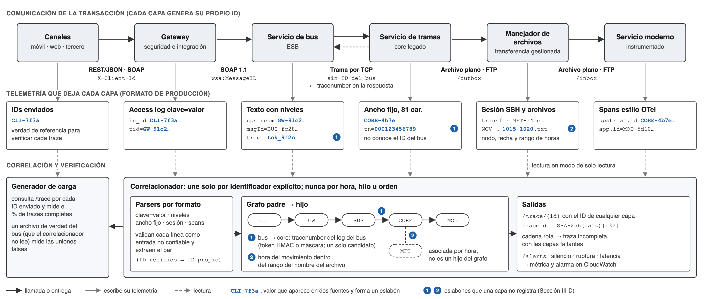
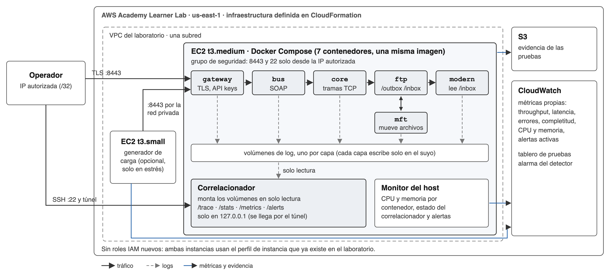

# obsproto — Observabilidad de punta a punta en sistemas heterogéneos

[](https://github.com/julian012/M_AYGO-chaining-observability/actions/workflows/ci.yml)

Prototipo de investigación del curso *Arquitectura y Gobernabilidad Tecnológica* (Escuela Colombiana de Ingeniería Julio
Garavito). Demuestra cómo **reconstruir la traza de punta a punta** cuando cada capa (gateway, servicio de bus, servicio de
tramas, manejador de archivos y servicio moderno) genera **su propio identificador** y **no puede modificarse** para compartir
uno: se **encadenan** los identificadores que cada capa ya registra.

> Todo es genérico y con **datos sintéticos**. No se usan datos, nombres ni logs reales de ninguna organización.

## Entregables y dónde están

| Entregable del curso | Dónde |
|---|---|
| Artículo científico (formato IEEE) | Entregado aparte; su evidencia está en [`evidence/`](evidence/) |
| Artefactos de arquitectura | [`docs/`](docs/): vistas C4 y principios ([`architecture.md`](docs/architecture.md)), 8 ADR ([`docs/adr/`](docs/adr/)), modelo de amenazas STRIDE ([`threat-model.md`](docs/threat-model.md)), 11 atributos de calidad ([`quality-attributes.md`](docs/quality-attributes.md)), formatos de log ([`log-formats.md`](docs/log-formats.md)) y flujo paso a paso ([`flujo-y-telemetria.md`](docs/flujo-y-telemetria.md)) |
| Prototipo en AWS | Código en [`src/`](src/), infraestructura en [`infra/`](infra/), pruebas en [`tests/`](tests/), pruebas de estrés en [`scripts/`](scripts/) y resultados en [`evidence/`](evidence/) |

## Cómo funciona



Cada capa registra el par **identificador recibido → identificador propio**. El correlacionador lee las cinco fuentes en modo de
solo lectura, arma el grafo de identificadores y responde `GET /trace/<CUALQUIER ID>` con la traza completa, o con las capas
faltantes si un eslabón no quedó registrado. Un detector vigila la completitud y la latencia y señala la capa afectada.
Detalle en [`docs/architecture.md`](docs/architecture.md) y [`ADR-0001`](docs/adr/0001-id-chaining.md).

## Requisitos
Docker y Compose v2, `openssl` y Python 3.10 o superior (para el generador de carga y las pruebas).

## Inicio rápido (local)
```bash
make up                         # genera .env y el certificado TLS, construye y levanta las siete capas
make load N=300 C=15            # carga sintética por tres canales y % de trazas completas
make stats                      # estadísticas del correlacionador
make trace ID=CLI-xxxxxxxxxxxx  # traza a partir de cualquier ID (también GW-, BUS-, CORE-, MOD-)
make down                       # detener (make clean borra los logs)
```
- Fallos en el core: `FAULT_RATE=0.1` en `.env` y `docker compose up -d`.
- Bus sin el par de identificadores (ruptura de la cadena): `BUS_LOG_LEVEL=INFO docker compose up -d bus`.
- Core que no recibe el ID del bus y política de registro del *tracenumber*: `scripts/core_link_experiment.py` ([ADR-0006](docs/adr/0006-core-tracenumber-link.md)).
- Anomalías inyectadas en caliente: `scripts/anomaly_experiment.py`. Retención e históricos: `scripts/replay_history.py`.

## Pruebas y calidad
```bash
pip install -e ".[dev]"
make test      # 138 pruebas: parsers de las cinco fuentes, SOAP y tramas (incl. XXE), grafo, uniones por tracenumber y por archivo, detector
make lint      # ruff y cfn-lint
```
Integración continua (GitHub Actions): lint, pruebas en Python 3.10 y 3.12, cfn-lint, gitleaks, pip-audit, Trivy (plantilla e
imagen) y hadolint.

## Despliegue en AWS (Learner Lab)



Ver [`infra/README.md`](infra/README.md): CloudFormation, sin recursos IAM nuevos, una EC2 con Docker Compose, tablero y alarma de
CloudWatch, bucket S3 cifrado y acceso solo desde una IP autorizada. Las pruebas de estrés se ejecutan con
[`scripts/run_scenarios.sh`](scripts/run_scenarios.sh) desde una segunda instancia.

## Resultados principales
Unas 60 000 transacciones verificadas en AWS: **100 %** de trazas completas cuando cada eslabón quedó registrado, sin overhead
medible y con cero uniones falsas; **0 %** con el bus sin logs DEBUG; localización **30,9 veces** más rápida que el cruce manual;
anomalías detectadas en 1,2 a 19,0 s. Detalle por escenario en [`evidence/README.md`](evidence/README.md).

## Seguridad
Modelo STRIDE con 27 amenazas, sus controles y 12 riesgos residuales declarados, siguiendo los principios de confianza cero:
[`docs/threat-model.md`](docs/threat-model.md) · [`SECURITY.md`](SECURITY.md) · [`ADR-0004`](docs/adr/0004-security-baseline.md).

## Estructura
```
src/obsproto/              gateway, bus, core, ftpserver, mft, modern; wire (SOAP y tramas), schema, tracelink
src/obsproto/correlator/   parsers, graph (grafo de IDs), corelink, filelink, detector, server (API)
tests/                     pruebas unitarias y de entradas hostiles
scripts/                   carga, escenarios de estrés, experimentos, métricas de CloudWatch, monitor del host
infra/                     plantilla CloudFormation y guía
docs/                      arquitectura (C4), ADR, amenazas, atributos de calidad, formatos de log, figuras
evidence/                  resultados de cada corrida, con su README
```

## Licencia
MIT.
