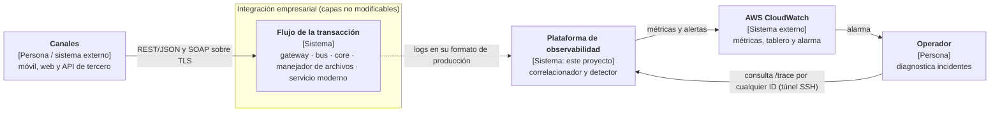
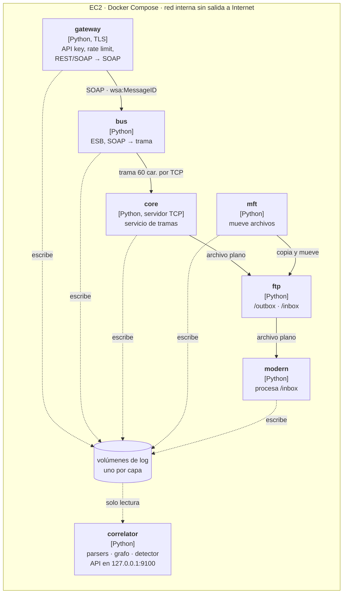
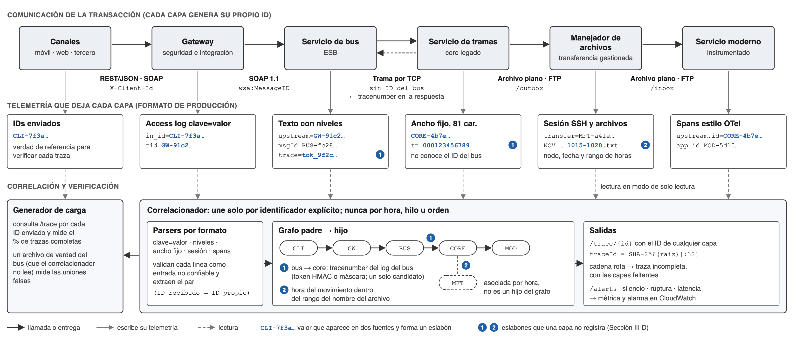
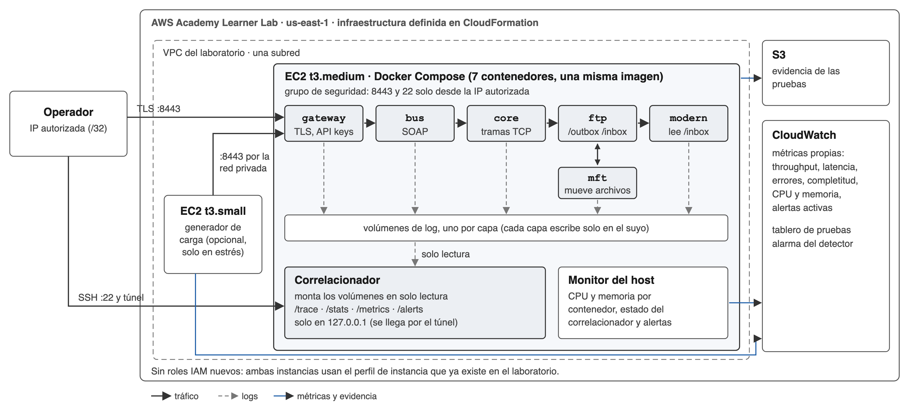

# Arquitectura

## Problema
Una operación de negocio nace en varios canales (móvil, web, API expuesta a terceros) y, según la lógica del negocio, atraviesa
varias capas: **gateway → servicio de bus → servicio de tramas (core legado) → manejador de archivos → servicio moderno**. Cada
capa genera **su propio identificador** y ninguna puede modificarse para propagar uno común. Seguir una transacción exige cruzar
los logs a mano, capa por capa.

## Solución: encadenamiento de identificadores
No se intenta unificar el identificador. Cada capa ya registra **el que recibió y el que generó**; ese par es un eslabón. El
correlacionador lee la telemetría de todas las capas en modo de solo lectura, arma un grafo dirigido con los eslabones y
reconstruye la traza `CLI → GW → BUS → CORE → MOD`, con la transferencia del archivo (MFT) asociada al movimiento del core. El
identificador canónico de la traza es `SHA-256(raíz)[:32]`, el formato de un trace-id de OpenTelemetry. El modelo es
**determinista**: une solo por identificador explícito y, si falta un eslabón, reporta la traza incompleta con las capas
faltantes ([ADR-0001](adr/0001-id-chaining.md)).

## Vista de contexto (C4, nivel 1)

## Vista de contenedores (C4, nivel 2)

## Comunicación y formación de los eslabones

Arriba, el protocolo de cada salto y dónde viaja el identificador anterior; en el medio, la telemetría que deja cada capa (los
valores en azul aparecen en dos fuentes y forman un eslabón); abajo, el correlacionador. Los eslabones 1 y 2 son los que una capa
no registra: el *tracenumber* del core, que solo queda en el log del bus ([ADR-0006](adr/0006-core-tracenumber-link.md)), y la
transferencia del archivo plano, que se ubica por el rango de horas de su nombre ([ADR-0008](adr/0008-mft-file-transfer-link.md)).
Mensajes y logs reales de cada capa, paso a paso: [flujo-y-telemetria.md](flujo-y-telemetria.md).

## Componentes

| Contenedor | Simula | ID propio (padre) | Entrada | Telemetría |
|---|---|---|---|---|
| `gateway` | Gateway de seguridad e integración (plataforma cerrada) | `GW-` (`CLI-`) | REST/JSON y SOAP 1.1 | Access log `clave=valor` |
| `bus` | Servicio de bus (ESB) | `BUS-` (`GW-`) | SOAP 1.1, ID en `wsa:MessageID` | Texto con niveles; el par en DEBUG o en el perfil *resumen* |
| `core` | Servicio de tramas (core legado) | `CORE-` (`BUS-`, o ninguno si asigna su *tracenumber*) | Trama de ancho fijo por TCP | Registro de ancho fijo de 81 caracteres |
| `ftp` | Servidor de archivos | — | Archivos planos del core | — |
| `mft` | Manejador de archivos (transferencia gestionada) | `MFT-` (asociado por rango de horas) | Archivo en `/outbox` | Log de sesión y de archivo |
| `modern` | Servicio moderno instrumentado | `MOD-` (`CORE-`) | Archivo plano en `/inbox` | Spans al estilo OpenTelemetry |
| `correlator` | Plataforma de observabilidad | — | Logs de las cinco capas (solo lectura) | `/trace`, `/stats`, `/metrics`, `/alerts` |

Todos los nombres son genéricos y los datos son sintéticos. Formatos exactos: [log-formats.md](log-formats.md).

## Propiedades del correlacionador
- Se consulta por **cualquier ID** de cualquier capa; sube hasta la raíz y desciende.
- Independiente del orden de llegada (los hijos terminan antes que sus padres) e idempotente ante duplicados.
- Nunca une por hora, por hilo ni por orden. Los eslabones que ningún evento trae (tracenumber, transferencia de archivo) se
  resuelven solo cuando existe un único candidato.
- Memoria acotada: al llenarse descarta el evento más antiguo **según su hora**, no el primero que llegó.
- Un detector evalúa cada 2 s tres reglas (fuente silenciosa, cadena rota, latencia) y nombra la capa afectada; sus alertas se
  publican en CloudWatch, donde una alarma se dispara mientras haya una activa.

## Despliegue

- **Local:** `docker compose` (ver el README).
- **AWS (Learner Lab):** una EC2 con Docker Compose, definida en CloudFormation (`infra/template.yaml`), con un tablero y una
  alarma de CloudWatch y un bucket S3 cifrado para la evidencia. Una segunda EC2 genera la carga durante las pruebas de estrés.
  Ver [ADR-0002](adr/0002-ec2-compose-vs-eks.md).

## Principios de arquitectura y gobierno
Siguiendo el formato de principios de TOGAF (enunciado, justificación e implicaciones), el resultado de gobierno del proyecto es
el **contrato mínimo de log**:

| Principio | Justificación (experimento) | Implicación |
|---|---|---|
| Cada eslabón se registra en al menos una de sus dos capas, en un nivel activo en producción | Con el bus sin DEBUG, 0 % de trazas completas | Revisar los niveles de log de cada integración |
| Un identificador sensible se tokeniza, no se enmascara | El token une siempre; la máscara depende de la carga | Gestionar la llave de tokenización |
| Cada archivo lleva en su nombre origen, fecha y rango de horas | Permite ubicar la transferencia sin abrir el archivo | Convención de nombres para los intercambios por archivo |
| La telemetría de cada dependencia se centraliza en solo lectura | Hace posible detectar anomalías en segundos | Acuerdo entre las áreas dueñas de cada log |
| La retención se alinea entre todas las fuentes | La fuente más corta fija el alcance histórico | Política de retención común |

La seguridad sigue los principios de confianza cero (mínimo privilegio, verificación explícita y supuesto de brecha); el detalle
y los riesgos residuales están en [threat-model.md](threat-model.md).

## Evolución prevista
1. Persistir el grafo para consultar transacciones fuera de la ventana en memoria.
2. Exportar las trazas reconstruidas por OTLP (OpenTelemetry Collector → Tempo o Jaeger) y visualizarlas en Grafana.
3. Validar el modelo con productos reales (gateway de integración, ESB, core y manejador de archivos con SFTP).
4. Escalar horizontalmente el gateway o terminar TLS en un balanceador; mTLS entre servicios internos.
5. Evaluar un asistente de diagnóstico con RAG sobre la traza reconstruida ([propuesta](figuras/propuesta-agente-ia.png)).
