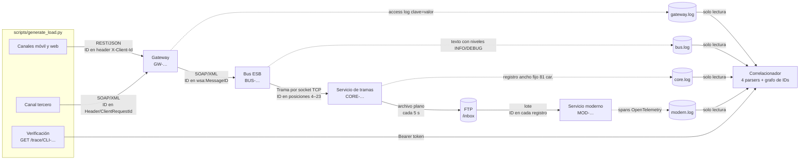
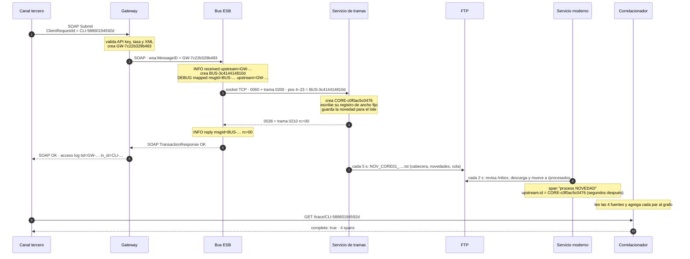

# Flujo de una transacción y telemetría de cada capa

> Vista visual de este mismo contenido, con el ejemplo del caso tracenumber y los resultados: [`visual/flujo-trazabilidad.html`](visual/flujo-trazabilidad.html) (ábrelo en el navegador).
> Detalle de cada formato y de las reglas de validación: [`log-formats.md`](log-formats.md). Decisión: [ADR-0005](adr/0005-heterogeneous-sources.md).

Cada capa habla un **protocolo distinto**, genera **su propio ID** y deja **telemetría en un formato distinto**.
Ninguna propaga el ID original: solo le entrega el suyo a la siguiente. El correlacionador lee las cuatro fuentes
(en modo de solo lectura) y reconstruye la cadena uniendo los pares *ID recibido → ID propio*.

Todos los ejemplos son de una transacción real por el canal de tercero (SOAP), en Docker local el 18-nov-2026.
Lo único ilustrativo es el número de cuenta, porque ninguna capa lo registra (minimización de datos).

```
CLI-58860194592d ─SOAP→ GW-7c22b329b483 ─SOAP→ BUS-3c414414810d ─TRAMA→ CORE-c0f0ac5c0476 ─REST→ MOD-2be516eecb9b
```

## 1. Montaje



El generador hace de los tres canales. De cada transacción solo conoce el `CLI-` que creó, igual que un cliente real.
Al terminar le pide al correlacionador la traza de cada `CLI-` y cuenta cuántas tienen las cuatro capas.

> **Gateway como plataforma cerrada.** Un gateway comercial de integración no se programa en Python: sus transformaciones se escriben en XSLT
> o GatewayScript. El stand-in está en Python, pero lo que simula es su comportamiento visible: recibe REST o SOAP,
> valida, transforma a SOAP y deja un access log de texto. La correlación solo depende de ese comportamiento.

## 2. Lo que viaja por la red

| Salto | Protocolo | Dónde viaja el ID de la capa anterior | Endpoint |
|---|---|---|---|
| Móvil / web → Gateway | REST/JSON | Header `X-Client-Id` | `POST /v1/transactions` |
| Tercero → Gateway | SOAP 1.1/XML | `soapenv:Header/txn:ClientRequestId` | `POST /soap/v1/transactions` |
| Gateway → Bus | SOAP 1.1/XML | `soapenv:Header/wsa:MessageID` (WS-Addressing) | `POST /ws/TransactionService` |
| Bus → Core | Trama de ancho fijo por **socket TCP**, precedida de su longitud en 4 dígitos | Posiciones 4–23 de la trama | `core:9000` |
| Core → Moderno | **Archivo plano por FTP**, en lotes cada 5 s (asíncrono) | Posiciones 2–21 de cada registro de detalle (no hay `traceparent`) | `ftp: /inbox → /procesados` |

**Gateway → Bus (SOAP).** El bus rechaza cualquier `<!DOCTYPE` o `<!ENTITY` antes de parsear (XXE) y exige los tres campos exactos.

```xml
<soapenv:Envelope xmlns:soapenv="http://schemas.xmlsoap.org/soap/envelope/"
    xmlns:wsa="http://www.w3.org/2005/08/addressing" xmlns:txn="urn:obsproto:txn:v1">
  <soapenv:Header>
    <wsa:MessageID>GW-7c22b329b483</wsa:MessageID>
  </soapenv:Header>
  <soapenv:Body>
    <txn:Transaction>
      <txn:Type>BAL</txn:Type>
      <txn:Account>482913377</txn:Account>
      <txn:AmountCents>7356</txn:AmountCents>
    </txn:Transaction>
  </soapenv:Body>
</soapenv:Envelope>
```

**Bus → Core (trama).** No tiene nombres de campo: el significado sale de la posición, como en un copybook.

```
Solicitud (60):  0200BUS-3c414414810d    BAL 482913377           000000007356
                 mti └──────bus_id──────┘txn └─────account──────┘└──amount──┘
Respuesta (26):  0210BUS-3c414414810d    00
                 mti └──────bus_id──────┘rc  (00 = OK, 91 = fallo; el resultado no va en el código HTTP)
```

### Core → Moderno: archivo plano por FTP (asíncrono)
Cada 5 s el core junta las novedades de los movimientos exitosos en un archivo de ancho fijo de 63 caracteres por línea. Lo sube
por FTP a `/inbox` como `.tmp` y luego lo renombra, para que nunca se lea a medias. El moderno revisa la carpeta cada 2 s,
comprueba que la cola cuadre con el número de registros (si no cuadra, aparta el archivo como `.err`), emite un span por
registro y lo mueve a `/procesados`.

```
NOV_CORE01_20261119072101559.txt
0020261119072101CORE01                                           ← cabecera: fecha-hora y nodo
01CORE-42fa0e7f8832   BAL 0000000073560020261119072059670        ← novedad: ID del core, txn, monto, estado, hora
9900000001                                                       ← cola: cantidad de novedades
```
El cliente recibe su respuesta cuando el core contesta la trama, y el moderno se entera después. **La traza queda incompleta unos
segundos y luego se completa sola.** En local: entre 2,2 y 3,0 s después de la respuesta (mediana 2,4 s). El máximo teórico es
el intervalo del lote más el de revisión, unos 7 s. En producción los lotes suelen ser de minutos u horas.

## 3. La escalera

Cada capa en línea escribe su log cuando la siguiente le responde, así que los registros salen en orden inverso al
recorrido; el moderno llega después, con el lote FTP. El bus escribe tres líneas: al recibir, al crear su ID (DEBUG) y al recibir la respuesta.
**El correlacionador no usa el orden ni las horas para unir; usa solo los IDs.**



## 4. Telemetría de cada servicio

De la fuente con más contexto de traza a la que no tiene ninguno:

| Nivel | Tipo de fuente | Capa | Dónde está el par de IDs | Parser |
|---|---|---|---|---|
| A | Trazas nativas (spans OpenTelemetry) | Moderno | Atributos `upstream.id` → `app.id`. Su `traceId` es propio, porque nadie le propagó `traceparent` | `parse_span_line` |
| B | Texto `clave=valor` (access log) | Gateway | Una línea: `in_id` → `tid` | `parse_gateway_line` |
| C | Texto con niveles INFO/DEBUG | Bus | **Solo en la línea DEBUG** `mapped` | `BusLogParser` (con estado) |
| D | Registro posicional de ancho fijo | Core | Posiciones 17–36 (propio) y 37–56 (recibido) | `parse_core_line` |

```text
# Gateway (access log)
2026-11-18T14:42:28.676Z INFO  gateway tid=GW-7c22b329b483 in_id=CLI-58860194592d ch=partner proto=SOAP status=200 upstream=200 dur_ms=14

# Bus (texto con niveles)
2026-11-18T14:42:28.661Z INFO  [ESB.TransactionRoute] thread=T30496 received SOAP Submit upstream=GW-7c22b329b483
2026-11-18T14:42:28.661Z DEBUG [ESB.TransactionRoute] thread=T30496 mapped msgId=BUS-3c414414810d upstream=GW-7c22b329b483 out=CORE.TRAMA
2026-11-18T14:42:28.675Z INFO  [ESB.TransactionRoute] thread=T30496 reply msgId=BUS-3c414414810d rc=00 dur_ms=14

# Core (ancho fijo, 81 caracteres)
20261118144228675CORE-c0f0ac5c0476   BUS-3c414414810d    BAL 00000000735600000014
└──────ts───────┘└─────core_id──────┘└────parent_id─────┘txn └──amount──┘st└dur─┘

# Servicio moderno (span OTel, una línea)
{"resource":{"service.name":"modern-notifications"},"traceId":"ba6be01a7a24f5697e8a1c69d6791517","spanId":"7613e9a877ac7f45","parentSpanId":"","name":"process NOVEDAD","kind":"SPAN_KIND_SERVER","startTimeUnixNano":1795012948675771041,"endTimeUnixNano":1795012948675825208,"status":{"code":"STATUS_CODE_OK"},"attributes":{"app.id":"MOD-2be516eecb9b","upstream.id":"CORE-c0f0ac5c0476","http.request.method":"POST","http.response.status_code":200}}
```

## 5. La traza reconstruida

`GET /trace/BUS-3c414414810d` (se puede consultar con el ID de cualquier capa):

```json
{"traceId":"e77490eecd8593491a7e08e191cb029a","rootId":"CLI-58860194592d","complete":true,"missingLayers":[],
 "spans":[
  {"layer":"gateway","id":"GW-7c22b329b483","parentId":"CLI-58860194592d","startOffsetMs":1,"durationMs":14,"status":"200"},
  {"layer":"bus","id":"BUS-3c414414810d","parentId":"GW-7c22b329b483","startOffsetMs":0,"durationMs":14,"status":"00"},
  {"layer":"core","id":"CORE-c0f0ac5c0476","parentId":"BUS-3c414414810d","startOffsetMs":0,"durationMs":14,"status":"00"},
  {"layer":"modern","id":"MOD-2be516eecb9b","parentId":"CORE-c0f0ac5c0476","startOffsetMs":14,"durationMs":0,"status":"OK",
   "otelTraceId":"ba6be01a7a24f5697e8a1c69d6791517"}]}
```

El `traceId` canónico se calcula del ID raíz (SHA-256 truncado a 32 hex). El span del servicio moderno conserva su
`otelTraceId`, así que la traza OTel que había quedado huérfana también queda enlazada al flujo completo.

## 6. Primer hallazgo: con el bus en INFO la cadena se rompe

Es la misma carga en Docker local y solo cambia `BUS_LOG_LEVEL`:

| Bus | Transacciones | Trazas completas | Respuestas del bus sin padre | Evidencia |
|---|---|---|---|---|
| DEBUG | 300 | **300 (100 %)** · 496 rps · p95 44,6 ms | 0 | `evidence/local-hetero-debug-2026-11-18.json` |
| INFO | 150 | **0 (0 %)** | 150 | `evidence/local-hetero-bus-info-2026-11-18.json` |

En INFO la línea que une el ID recibido con el propio no se escribe, y la traza se parte en dos fragmentos:
`CLI → GW` ✕ `BUS → CORE → MOD`. El correlacionador **no adivina** el enlace por hilo ni por hora, porque bajo
concurrencia eso inventaría relaciones falsas. Prefiere reportar la traza como incompleta.

**Regla de gobernanza (contrato mínimo de log):** cada capa debe dejar el par *ID recibido → ID propio* en una misma
línea, con un nivel activo en producción (INFO o superior). No hace falta modificar las aplicaciones, solo configurar
cómo registran.

## 6b. Cuando el core no recibe el ID del bus (tracenumber)

En el caso real el core no recibe el ID del bus: asigna a cada movimiento un **consecutivo que nunca se repite** (*tracenumber*)
y lo devuelve en la respuesta. El bus no tiene DEBUG en producción y en INFO ese valor queda ofuscado. El eslabón bus → core
solo puede salir de la línea de respuesta del bus ([ADR-0006](adr/0006-core-tracenumber-link.md)).

```
Bus → Core     trama 0200: (campo del bus vacío) PAY 261973069 000000207101
Core → Bus     trama 0210: rc=00 tracenumber=795070117166
bus.log        INFO reply msgId=BUS-… upstream=GW-… rc=00 trace=<según la política> dur_ms=32
core.log       20261119…CORE-795070117166   (vacío)               PAY 00000020710100000039
```

| Política del bus | Cómo queda | Cómo se une | Trazas completas | Uniones falsas |
|---|---|---|---|---|
| `clear` | `trace=795070117166` | Igualdad | 100 % | 0 |
| `token` | `trace=tok_11f558a938873f72` | HMAC recalculado sobre el core | 100 % | 0 |
| `mask` 4 dígitos | `trace=********6178` | Terminación + hora (único candidato) | 100 % | 0 |
| `mask` 3 dígitos | `trace=*********081` | Igual | 20 % (resto ambiguo) | 0 |
| `mask` 2 dígitos | `trace=**********63` | Igual | 0 % (ambiguo) | 0 |
| `none` | — | — | 0 % | 0 |

Con *v* dígitos visibles la terminación es única mientras en la ventana (±5 s) haya menos de 10^v movimientos. Por eso la
máscara depende de la carga y el token no. Regla: **si se ofusca, tokenizar**. Evidencia: `evidence/core-link-local-2026-11-19/`.

## 7. Escenarios de carga

**Resultados medidos en AWS (18/19-nov):** [`evidence/aws-stress-2026-11-18/README.md`](../evidence/aws-stress-2026-11-18/README.md).

Cada escenario se publica en el tablero de CloudWatch `obsproto-pruebas` con su nombre (`--cw-scenario`), junto con la CPU y
memoria de cada contenedor y el estado del correlacionador. Ver [`infra/README.md`](../infra/README.md).


| Escenario | Qué se cambia | Qué se espera | Métrica |
|---|---|---|---|
| Calentamiento | Una corrida corta antes de medir; no se reporta | Evitar el arranque en frío | — |
| Normal | 500 transacciones, C=20, 3 repeticiones | 100 % de trazas completas | rps, p50/p95/p99, % completas |
| REST frente a SOAP | Misma carga, con y sin `--rest-only` | Costo del XML en la latencia | `byProtocol` p50/p95 |
| Escalones | C = 10 → 20 → 50 → 100 → 200 | Punto de saturación | rps máximo, errores, CPU |
| Sostenida | 10 min a ~70 % del máximo | Memoria del correlacionador estable | RSS, % completas en el tiempo |
| Nivel de log del bus | `BUS_LOG_LEVEL` = DEBUG o INFO | Ruptura de la cadena en INFO | % completas, `busUnlinkedReplies` |
| Fallos del core | `FAULT_RATE=0.1` | Trama con `rc=91`, error al cliente, traza completa sin `MOD-` | % completas |
| Caída del bus | `docker stop bus` a mitad de la corrida | Trazas incompletas reportadas, sin enlaces inventados | Incompletas detectadas, recuperación |
| Overhead | Con y sin correlacionador | Diferencia pequeña (está fuera del camino) | Δ latencia, Δ CPU |
| Manual frente a modelo | Localizar 10 transacciones con `grep` en 4 logs frente a `/trace` | Mucho menos tiempo con el modelo | Segundos por transacción |

**Arranque en frío.** La primera corrida después de levantar la pila en local dio 89 rps y p95 cercano a 2 s, casi lo
mismo que en AWS (87 rps). Con la pila caliente, la misma carga dio entre 456 y 496 rps con p95 de 45 a 49 ms. Por eso
cada escenario empieza con una corrida de calentamiento. Falta confirmarlo en AWS, generando la carga desde otra instancia.

**Límite de tasa.** El gateway acepta 200 transacciones por segundo por canal (ráfaga de 400). Por encima de ~600 rps
sostenidas aparecen respuestas 429, que se reportan aparte para no confundirlas con saturación.
